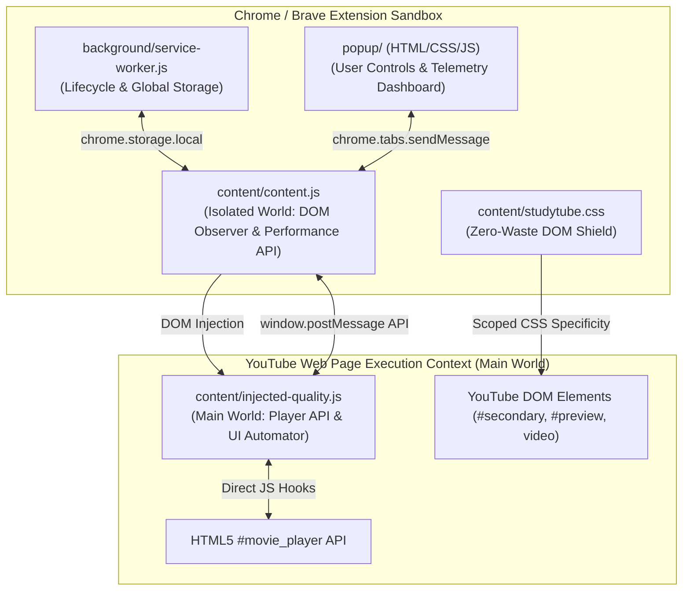

# 🛠️ Engineering Architecture & Technical Specification (V1)
**Product**: StudyTube (Manifest V3 Bandwidth Optimization & Telemetry Engine)  
**Author**: Krishnamurthi 
**Version**: 1.0.0 | **Language / Stack**: JavaScript (ES6+), HTML5, CSS3, Manifest V3  

---

## 1. High-Level Architecture Overview

StudyTube utilizes the **Manifest V3 multi-world execution architecture**, maintaining a clean boundary between Chromium's extension sandbox and YouTube's internal execution context:



---

## 2. Component Specifications

### 2.1 Background Service Worker (`background/service-worker.js`)
* **Role**: Event-driven background controller.
* **Responsibilities**:
  1. Handles extension installation and migration events via `chrome.runtime.onInstalled`.
  2. Seeds default configuration keys into `chrome.storage.local`.
  3. Maintains global cumulative data meters (`totalSavedMb`, `totalConsumedMb`) across sessions.
  4. Complies with Manifest V3 ephemeral lifecycle (does not maintain long-running memory state).

### 2.2 Content Script (`content/content.js`) — Isolated World
* **Role**: Primary client-side coordinator operating within the content script sandbox.
* **Responsibilities**:
  1. **Telemetry Capture**: Instruments the `PerformanceObserver` API with `type: 'resource'`, filtering for URI signatures containing `googlevideo.com` and `videoplayback`.
  2. **Active Playback Clock**: Tracks actual video playing time via HTML5 `video.onplay`, `video.onpause`, and `video.onended` listeners.
  3. **Content Classifier (Glass-Box Engine)**: Inspects `document.title` and `<meta name="description">` to categorize content into one of four domain classes (`Whiteboard`, `Coding`, `Seminar`, `Music/Audio`).
  4. **DOM Mutation & State Injection**: Toggles `studytube-block-waste` and `studytube-audio-first` on `document.body`.
  5. **Modal & Banner Orchestrator**: Renders the in-page **Glass-Box Recommendation Pill** and **Session Recap Modal**.

### 2.3 Main World Bridge (`content/injected-quality.js`)
* **Role**: Injected DOM executable that has access to YouTube's window-level objects.
* **Responsibilities**:
  1. **Player API Hooking**: Executes `player.setPlaybackQualityRange(target, target)` and `player.setPlaybackQuality(target)` directly on `document.getElementById('movie_player')`.
  2. **Autoplay Suppression**: Invokes `player.setAutonav(false)` to prevent auto-queuing.
  3. **UI Automation Fallback Engine**: If YouTube's player API ignores programmatic quality calls, programmatically triggers the gear menu (`.ytp-settings-button`), navigates to Quality, selects the matching resolution item (`720p`, `480p`, `144p`), and collapses the menu in <100ms.

### 2.4 Zero-Waste DOM Shield (`content/studytube.css`)
* **Role**: CSS-driven resource suppression.
* **Rules Matrix**:
  - `#secondary`, `#related`: Suppresses entire right-hand sidebar recommendation feeds, preventing invisible thumbnail downloads.
  - `ytd-watch-flexy[flexy] #primary`: Re-centers the video player for a distraction-free cinematic layout.
  - `ytd-rich-section-renderer:has(ytd-rich-shelf-renderer[is-shorts])`: Suppresses background Shorts chunk preloading.
  - `#inline-preview-player`: Disables silent hover playback streams.
  - `.ytp-ce-element`: Removes heavy end-screen video overlay thumbnails.

---

## 3. Mathematical Telemetry & Data Estimation Model

### 3.1 Consumed Data Calculation
$$\text{Consumed MB} = \frac{\sum \text{transferSize of } (\text{URL} \supset \text{"googlevideo.com"})}{1024 \times 1024}$$

### 3.2 Savings Modeling
Default YouTube auto-streaming on desktop Chromium typically delivers 1080p60 / 1080p streams averaging **$\approx 3.6\text{ MB/min}$**.

$$\text{Baseline Expected MB} = \text{Active Playing Minutes} \times 3.6\text{ MB/min}$$

$$\text{Suppressed Waste MB} = \begin{cases} 
\text{Active Playing Minutes} \times 0.7\text{ MB/min} & \text{if Zero-Waste Shield is Active} \\ 
0 & \text{otherwise} 
\end{cases}$$

$$\text{Net Saved MB} = \max\left(0, (\text{Baseline Expected MB} - \text{Consumed MB}) + \text{Suppressed Waste MB}\right)$$

$$\text{Conserved Percentage} = \text{round}\left(\frac{\text{Net Saved MB}}{\text{Consumed MB} + \text{Net Saved MB}} \times 100\right)$$

---

## 4. Local Storage Schema (`chrome.storage.local`)

```json
{
  "enabled": true,
  "mode": "board",
  "blockWaste": true,
  "pauseInBackground": true,
  "audioFirst": false,
  "totalSavedMb": 438.1,
  "totalConsumedMb": 135.7,
  "lastSession": {
    "title": "MIT 18.06 Linear Algebra - Lecture 1",
    "watchSeconds": 1420,
    "consumedMb": 38.4,
    "savedMb": 112.6,
    "percentSaved": 74,
    "mode": "BOARD",
    "date": "01:45 AM",
    "timestamp": 1730510100000
  }
}
```

---

## 5. Security, Threat Model & Compliance Analysis

| Policy / Vector | Assessment | Mitigation Strategy |
| :--- | :--- | :--- |
| **YouTube Terms of Service** | Strictly compliant | Client-side DOM modification only. Does NOT alter, intercept, download, or rip streams. Never modifies advertisements. |
| **Chrome Web Store Single Purpose** | Fully compliant | Dedicated strictly to educational bandwidth conservation. Scoped strictly to `*://*.youtube.com/*`. |
| **Cross-Site Scripting (XSS)** | Protected | No `eval()`, no remote code injection. All scripts packaged locally in extension bundle. |
| **User Privacy & PII** | Zero data footprint | No user accounts, zero remote analytics beacons, 100% client-side storage. |

