# 📘 Product Requirements Document (PRD) — StudyTube v1.0
**Product Name**: StudyTube (Smart Bandwidth Telemetry & Context-Aware Study Mode)  
**Author**: Krishnamurthi  
**Status**: Ready for Production & Chrome Web Store Release  
**Version**: 1.0.0 | **Target Platform**: Chromium (Google Chrome, Brave, Microsoft Edge)  

---

## 1. Executive Summary & Vision

### 1.1 Problem Statement
Higher-education students in emerging markets (India, Southeast Asia, Latin America) rely heavily on YouTube as their primary learning portal (NPTEL, MIT OCW, coding bootcamps). However, over 68% access the internet through metered mobile hotspots (1.5GB–3GB/day) or congested hostel Wi-Fi. 

Standard YouTube video streaming forces a toxic dilemma:
1. **The Over-Consumption Trap**: YouTube defaults to 1080p/720p 60fps auto-bitrates, while silently prefetching unrequested sidebar recommendation thumbnails, hover previews, and Shorts streams. A 45-minute lecture burns ~1.2GB–1.8GB, exhausting the student's entire daily quota.
2. **The Degradation Trap**: Native "Data Saver" features drop resolutions to 144p/240p, rendering blackboard calculus derivations, chemical notations, and IDE monospaced code syntax completely illegible, forcing students to abandon lectures.
3. **The Commercial Background Drain**: In small public businesses (gyms, salons, cafes), YouTube is kept playing on desktop browsers (like Brave) for 8–10 hours of background music over a single mobile dongle. High-resolution video streams burn 10GB–15GB daily, disconnecting digital UPI payment soundboxes and billing terminals mid-shift.

### 1.2 Product Vision
StudyTube is a **Glass-Box, Zero-Telemetry Browser Extension** that transforms YouTube into an efficient, intelligent study environment. Instead of degrading video resolution to unreadable levels, StudyTube **eliminates background data waste** (~250MB/hr), **locks context-aware legible resolutions (480p Talk / 720p HD Board & Code)**, **proactively classifies video content to recommend optimal settings**, and provides **provable, mathematical session telemetry with shareable receipts**.

---

## 2. Goals & Non-Goals

### 2.1 Primary Goals (North Star)
* **Preserve Educational Legibility**: Guarantee that handwritten blackboard equations and code syntax remain 100% legible across all educational playback modes.
* **50%–75% Bandwidth Reduction**: Achieve verified 50%–75% net data reduction compared to default YouTube auto-streaming on desktop Chromium browsers.
* **Proactive "Glass-Box" Guidance**: Automatically identify the incoming video category (Math/Whiteboard, Programming/IDE, Verbal Seminar, Background Audio) and provide explainable recommendations before playback waste occurs.
* **Mathematical Telemetry & Verifiability**: Provide students and commercial users with verifiable receipts of active stream time, megabytes transferred, and mobile plan percentage preserved.

### 2.2 Non-Goals
* **No Video/Audio Ripping or Downloading**: StudyTube will never download, rip, or re-encode media streams (strict compliance with YouTube ToS and Copyright laws).
* **No Ad Blocking or Monetization Interference**: StudyTube strictly avoids modifying or suppressing YouTube advertisements.
* **No Centralized PII Collection**: Zero external servers, analytics trackers, or user account mandates. All telemetry resides strictly within `chrome.storage.local`.

---

## 3. User Personas & Detailed Journeys

```mermaid
flowchart TD
    subgraph P1["Persona 1: Arjun (STEM Engineering Student)"]
        A1["Opens 90-min NPTEL Calculus Lecture"] --> A2["StudyTube AI detects 'Math / Whiteboard'"]
        A2 --> A3["Auto-locks Board Mode (720p HD) + Zero-Waste Shield"]
        A3 --> A4["Equations are razor sharp; sidebar waste blocked"]
        A4 --> A5["Generates verified 68% savings receipt for batchmates"]
    end
    
    subgraph P2["Persona 2: Vikram (Gym / Small Business Owner)"]
        B1["Runs Brave browser connected to gym sound system"] --> B2["StudyTube AI detects 'Gym Phonk Playlist'"]
        B2 --> B3["Switches to Audio-First Mode (144p stream, video hidden)"]
        B3 --> B4["Plays music for 10 hours using <900MB total"]
        B4 --> B5["UPI soundbox and billing stay online all day"]
    end
```



---

## 4. Functional Requirements (FR)

| Requirement ID | Module | Priority | Description |
| :--- | :--- | :---: | :--- |
| **FR-01** | Content Classification Engine | P0 | Analyze video title, metadata, and description in real-time to categorize content into: `Whiteboard/Math`, `Programming/Code`, `Verbal Seminar`, or `Music/Audio`. |
| **FR-02** | Glass-Box AI Recommendation Pill | P0 | Render a non-intrusive in-page recommendation banner explaining *why* a mode is suggested and allowing 1-click execution. |
| **FR-03** | Multi-Tier Quality Engine | P0 | Support 4 distinct modes: `Talk Mode (480p)`, `Board Mode (720p HD)`, `Code Mode (720p/1080p)`, and `Audio-First (144p video-hidden)`. |
| **FR-04** | Triple-Layer Quality Switcher | P0 | Ensure quality switches take effect via: (1) LocalStorage seed, (2) HTML5 Player API, and (3) Programmatic UI gear menu selection fallback. |
| **FR-05** | Zero-Waste Shield | P0 | Suppress sidebar recommendation thumbnails, hover video previews, Shorts chunk loading, and heavy end-screen overlays via DOM isolation. |
| **FR-06** | Real-Time Telemetry Hook | P0 | Intercept resource transfers via `PerformanceObserver` API filtering for `googlevideo.com` to compute actual streamed MB. |
| **FR-07** | Active Watch Time Tracker | P0 | Track playing time accurately (pauses counter when student pauses to take notes). |
| **FR-08** | In-Page Full-Screen Recap Modal | P0 | Present a comprehensive session receipt on video end or badge click with formatted shareable WhatsApp text. |
| **FR-09** | Toolbar Popup Telemetry Box | P0 | Persist the latest session metrics inside the extension popup even after the YouTube tab is closed. |
| **FR-10** | Background Tab Auto-Pause | P1 | Automatically halt video streaming when the student switches away from the YouTube tab to work on notes or code. |
| **FR-11** | Local Storage Synchronization | P0 | Sync cumulative savings and preferences across all Chromium tabs via `chrome.storage.local`. |
| **FR-12** | Single-Click Receipt Copy | P1 | Format and copy clipboard receipts with 1-click for peer verification. |

---

## 5. Non-Functional Requirements (NFR)

* **NFR-01 (Performance & Overhead)**: Memory usage must remain below 15MB RAM per YouTube tab. Injection latency must not exceed 50ms.
* **NFR-02 (Privacy & Security)**: Zero outbound network requests. No user tracking, no cookies, no analytics SDKs. Compliant with Google Chrome Web Store Single-Purpose and Privacy requirements.
* **NFR-03 (Browser Compatibility)**: Verified support on Chromium 115+ including Google Chrome, Brave Browser, and Microsoft Edge.
* **NFR-04 (Resilience to DOM Changes)**: If YouTube alters CSS classes or DOM hierarchy, the extension must fail gracefully without breaking video playback or causing console crashes.

---

## 6. Telemetry & Success Metrics

```
                    [North Star Metric]
           Average Daily Hotspot Data Conserved (MB)
                               │
            ┌──────────────────┴──────────────────┐
            ▼                                     ▼
 [Legibility Retention]                [Viral Referral Rate]
  Comprehension Score                  Shareable Receipt Copies
   (Target: ≥ 2.8 / 3.0)                (Target: ≥ 15% of sessions)
```

1. **North Star Metric**: Average Megabytes Saved per User per Day (Target: >350 MB/day).
2. **Quality Guardrail**: Student Comprehension Retention Rate (Must remain ≥90% across 720p/480p modes).
3. **Adoption & Engagement**: 
   - 7-day Active User Retention (Target: >55%).
   - Percentage of sessions utilizing Glass-Box Recommendations (Target: >40%).

