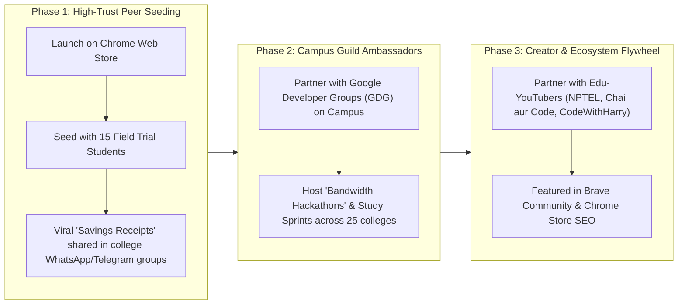

# 📊 Market Requirements Document (MRD) — StudyTube v1.0
**Product Name**: StudyTube (Global Bandwidth Optimization & Study Intelligence)  
**Author**: Krishnamurthi  
**Target Market**: Global Emerging Markets (India Primary, Southeast Asia, LATAM, Africa Secondary)  

---

## 1. Market Opportunity & Context

### 1.1 The "Next Billion Users" Bandwidth Paradox
Over the past decade, low-cost smartphones and affordable 4G/5G mobile plans (spearheaded by Reliance Jio and Airtel in India) brought 800+ million citizens online. However, while connectivity has expanded, **data limits remain strictly metered**:
* The standard prepaid mobile plan in India costs ₹239–₹349/month and provides **1.5GB to 2.5GB per day**.
* Once this daily allowance is consumed, throttling drops speeds to **64 Kbps** (effectively offline) or requires expensive top-up data packs.
* When students connect laptops to mobile hotspots for coursework, desktop operating systems and web applications treat the connection as an unlimited broadband pipe, aggressively buffering 1080p video, downloading background scripts, and burning daily quotas in under an hour.

### 1.2 Market Sizing (TAM, SAM, SOM)

```
[TAM: Global Video Learners on Metered Connections]
~140 Million Global Learners | Market Value: $4.2B Bandwidth Overhead
                       │
                       ▼
[SAM: Indian Higher-Education & Commercial Streamers]
~22 Million Users (18M STEM College Students + 4M Small Commercial Setups)
                       │
                       ▼
[SOM: StudyTube Year 1 Target]
250,000 Active Desktop Chromium Learners (Brave + Chrome)
```

1. **Total Addressable Market (TAM)**:
   - 140+ million post-secondary students across emerging markets (India, Indonesia, Brazil, Nigeria, Egypt, Philippines) watching video lectures over metered data connections.
2. **Serviceable Addressable Market (SAM)**:
   - 18.2 million Indian undergraduate STEM students (Engineering, Sciences, Medicine, Commerce) + 3.8 million small commercial establishments (gyms, salons, cafes, clinics) streaming background audio over dongles.
3. **Serviceable Obtainable Market (SOM - Year 1)**:
   - 250,000 monthly active users across Indian engineering colleges (IIITs, NITs, IITs, State universities) and desktop Brave/Chrome streamers.

---

## 2. Competitive Landscape & Product Defensibility

| Solution | Target User | Data Savings Strategy | Legibility of Diagrams/Code | Proactive Guidance | Proof / Receipt |
| :--- | :--- | :--- | :---: | :---: | :---: |
| **YouTube Native Mobile Data Saver** | Mobile app users | Drastic resolution downscaling (drops to 144p/240p) | ❌ Unreadable blur | ❌ None | ❌ None |
| **Unhook / DF Tube** | Distraction-conscious viewers | Hides recommendation feeds | ⚠️ Neutral (doesn't change video resolution) | ❌ None | ❌ None |
| **Enhancer for YouTube** | Power desktop users | 50+ manual toggles, forced resolution presets | ⚠️ Manual config required | ❌ None (no content awareness) | ❌ None |
| **StudyTube (Our Product)** | **Students & Hotspot Streamers** | **Zero-Waste Shield + Context-Aware Quality (720p/480p/Audio)** | **✅ 100% Crisp & Legible** | **✅ Glass-Box AI Advice** | **✅ Mathematical Shareable Receipt** |

### Why Existing Extensions Fail Indian Learners:
1. **The Configuration Burden**: Power-user extensions require navigating complex 50-item menus with technical terminology ("VP9 codec override", "DASH manifest buffers"). A student preparing for semester exams wants 1-click simplicity.
2. **The "Dumb Quality" Assumption**: Existing data savers assume lower resolution is always better. For STEM students, unreadable math formulas or coding syntax ruin the study session.
3. **Zero Transparency (Black Box)**: Users have no idea whether an extension actually saved 10MB or 500MB, breeding skepticism. StudyTube’s **Glass-Box Telemetry** provides verifiable proof.

---

## 3. Customer Segments & Value Propositions

### Segment 1: Tier-2/3 Higher Education STEM Students (Core ICP)
* **Demographics**: Ages 18–24; enrolled in B.Tech, BCA, BSc, MBBS, or CA prep; residing in student hostels or shared rentals.
* **Core Pain**: "I want to finish a 2-hour lecture on Dynamic Programming, but my laptop hotspot will eat my entire day's 2GB data."
* **Value Prop**: *"Watch the full lecture with sharp code clarity while saving 65% data for the rest of your day."*

### Segment 2: Small Commercial Establishments (Commercial ICP)
* **Demographics**: Gym managers, salon owners, cafe operators running desktop background music playlists for 8–12 hours daily.
* **Core Pain**: "Our workout music playlist drains our 3GB commercial SIM card by 2 PM, causing our UPI soundbox and QR billing terminal to disconnect during peak evening hours."
* **Value Prop**: *"Run all-day workout and background music on Brave/Chrome with 85% less data, keeping your billing and UPI soundbox online 100% of the time."*

### Segment 3: Daily Commute Learners
* **Demographics**: Students and young professionals preparing for UPSC, GATE, or GRE during daily bus/train commutes using tethered laptops.
* **Core Pain**: "Unstable 4G signals cause repeated buffering and data dropouts."
* **Value Prop**: *"Switch to Audio-First or 480p Talk Mode with 1 tap to stream seamlessly without buffer stalls."*

---

## 4. Go-To-Market (GTM) & Global Distribution Playbook



### Viral Loop Mechanics ("The Savings Receipt"):
1. A student finishes a difficult 45-minute lecture on calculus or algorithms.
2. StudyTube pops up the **Glass-Box Session Recap Modal**: *"You saved 284 MB (72% conserved). Preserved 19% of your 1.5GB daily pack."*
3. Student clicks **"📋 Copy Savings Receipt"** and pastes it into their class WhatsApp group:
   > *🎓 StudyTube Session Receipt: Studied 'Graph Algorithms' for 42m. Streamed 48MB, saved 212MB (78% conserved!). Preserved 14% of my Jio pack.*
4. Batchmates see real proof and install the extension via the Chrome Web Store link.

---

## 5. Monetization & Future Commercial Evolution

1. **Tier 1 (Core - Open Source & 100% Free Forever)**:
   - All client-side data saving, 4 lecture modes, zero-waste shield, and local session receipts remain completely free.
2. **Tier 2 (Campus / Enterprise Portal - Future B2B)**:
   - College campus network managers deploy StudyTube across hostel and library LANs to slash institutional broadband bandwidth costs by up to 50%.
   - Provides institutional dashboards showing aggregate gigabytes saved across campus subnets.

