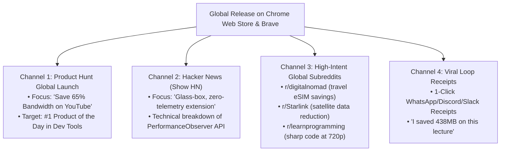

# 🌍 StudyTube: Global Scale, Market Strategy & GTM Playbook
**Product**: StudyTube (Global Bandwidth Optimization & Stream Telemetry)  
**Author**: Krishnamurthi  
**Scope**: Worldwide (North America, Europe, Asia-Pacific, Latin America, Africa)  

---

## 1. The Global Thesis: Why Bandwidth is a World Problem

Many Silicon Valley product specs mistakenly assume that data limits only affect developing countries. In reality, **bandwidth constraints and data caps are a universal friction point across the globe**:

```
[North America] ──────> 1.2 TB ISP Data Caps (Comcast Xfinity, Cox) with $10/50GB overage fees
[Europe / UK] ────────> Mobile tethering throttling & rising cost of living on multi-device plans
[Digital Nomads] ────> Expensive international travel eSIMs (Airalo, Holafly @ $4-$9 per GB)
[Global South] ───────> Prepaid daily data quotas (1.5GB-2GB/day) costing 2-5% of monthly income
[Rural / Satellite] ──> Starlink & Viasat high-latency, peak-hour fair-use bandwidth throttling
[Commercial Setups] ──> Gyms, cafes, salons worldwide running 10-hour background audio over dongles
```

### 1.1 The Worldwide Unit Economics of Video Streaming
* A single 4K/1080p stream pulls **~2.5GB to 4GB per hour**.
* In the **United States**, a family or shared student apartment streaming YouTube lectures, Netflix, and Zoom easily crosses Comcast’s **1.2 TB monthly data ceiling**, incurring automatic \$10 overage penalties per 50GB block.
* For a **Digital Nomad** working out of a train or cafe in Europe, Latin America, or Southeast Asia, a 3GB international travel eSIM costs \$15–\$25. Watching two 45-minute coding tutorials burns \$15 of data in one morning.
* For **Small Commercial Businesses** worldwide (gyms, cafes, salons, clinics), running background workout playlists on desktop browsers (like Brave) for 8–10 hours a day burns **10GB–15GB daily**, saturating Wi-Fi networks and causing payment terminals and Point-of-Sale (POS) systems to stall.

---

## 2. Global Persona Matrix

| Global Persona | Location | Primary Constraint | Trigger Event | Why StudyTube Solves It |
| :--- | :--- | :--- | :--- | :--- |
| **STEM Student / Self-Taught Dev** | Global (India, Brazil, US, Nigeria) | Metered 4G/5G mobile hotspot or shared campus Wi-Fi | Watching 2-hr DSA / Calculus lecture | **Board/Code Mode (720p HD)** keeps math formulas & code sharp while saving 50%+ data. |
| **Digital Nomad / Remote Worker** | US, Europe, LATAM, SEA | Expensive travel eSIMs (\$5-\$10/GB) on trains/cafes | Tethering laptop to phone hotspot for technical courses | **Talk Mode (480p)** cuts bandwidth by 65% with zero loss in slide or vocal clarity. |
| **Rural / Satellite Internet User** | US Rural, Australia, Maritime | Starlink / Viasat peak-hour congestion & fair use | Family members streaming while working | **Zero-Waste Shield** eliminates prefetch overhead without touching essential video streams. |
| **Gym & Small Business Manager** | Global | Single mobile dongle running desktop background audio | 10 hours continuous workout music on Brave/Chrome | **Audio-First Mode** saves 85% data, ensuring music plays all day while keeping POS terminals online. |

---

## 3. Global Go-To-Market (GTM) Launch Playbook



---

### Channel 1: Product Hunt Global Launch
* **Tagline**: `StudyTube: The Glass-Box Bandwidth Intelligence Engine for YouTube`
* **Maker Comment (Krishnamurthi)**:
  > *"Hey Product Hunt! I built StudyTube after seeing students and digital nomads repeatedly exhaust their daily mobile data and travel eSIMs on video lectures. Most data savers take the lazy route: they force 144p, making math equations and code editors completely unreadable. 
  > 
  > StudyTube does something different: it eliminates the ~250MB/hour of hidden background data waste (sidebar thumbnails, hover previews, Shorts pre-streaming) while locking in crisp, readable resolutions (480p for talks, 720p HD for whiteboards and code). Plus, it gives you a transparent, mathematically verifiable receipt of every megabyte saved. 100% client-side, zero tracking. Would love your feedback!"*

---

### Channel 2: Hacker News ("Show HN")
* **Title**: `Show HN: StudyTube – A zero-telemetry Chrome extension to cut YouTube data waste`
* **Technical Hook**:
  - Focus on the engineering architecture: how it hooks into the browser's native `PerformanceObserver` API to measure raw `transferSize` of video segments, bypasses YouTube player DOM overrides via a main-world bridge, and applies pure client-side heuristics to recommend modes without calling any cloud AI API.

---

### Channel 3: Global Subreddit Outreach
1. **r/digitalnomad (2.4M members)**:
   - *Title*: *"How I stopped YouTube from burning through my expensive travel eSIMs while working remotely"*
   - *Value*: Focus on hotspotting from laptops in trains, airports, and foreign Airbnbs.
2. **r/Starlink & r/rural_internet (250k members)**:
   - *Title*: *"Tool to stop YouTube from prefetching gigabytes of background recommendations on satellite connections"*
3. **r/Brave_Browser & r/privacy (300k members)**:
   - *Title*: *"Open-source, zero-telemetry tool for Brave: all-day YouTube audio without wasting gigabytes"*
4. **r/learnprogramming (4.1M members)**:
   - *Title*: *"Stop coding tutorials from draining your monthly data cap without making the syntax blurry"*

---

## 4. Product Principles & Strategic Moat

The core architectural and strategic principles that make StudyTube a defensible, high-impact global product:
1. **Universal Applicability**: Tackling a fundamental inefficiency in video streaming that impacts 1+ billion internet users worldwide on capped connections.
2. **First-Principles Trade-offs**: Rejecting naive brute-force degradation ("just lower resolution to 144p") and addressing the real root causes (unnecessary background prefetching waste + diagram readability thresholds).
3. **Glass-Box Integrity**: Building an explainable system that respects user privacy and proves its results with mathematical telemetry.
4. **End-to-End Product Execution**: Moving from problem discovery $\rightarrow$ user research $\rightarrow$ systems architecture $\rightarrow$ production code $\rightarrow$ PRD/MRD documentation $\rightarrow$ global distribution strategy. 🚀

